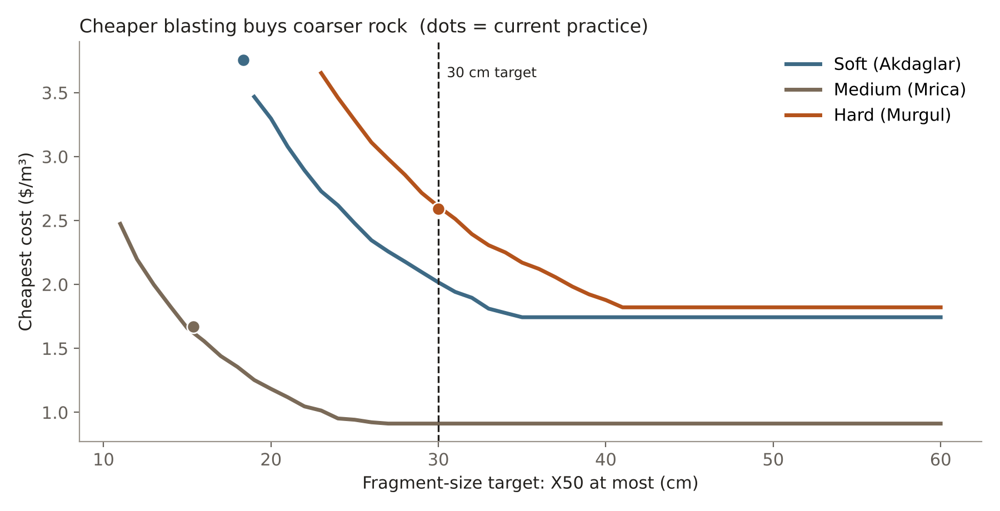
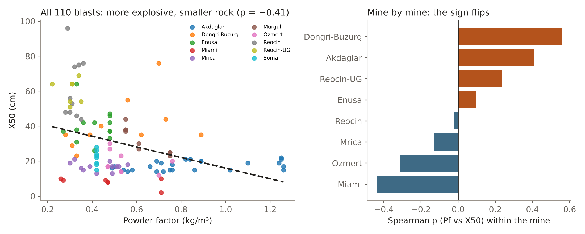
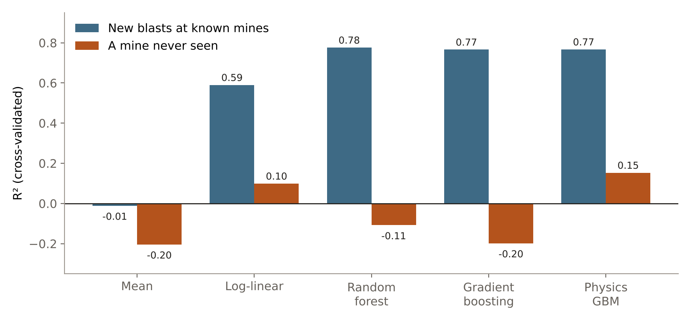
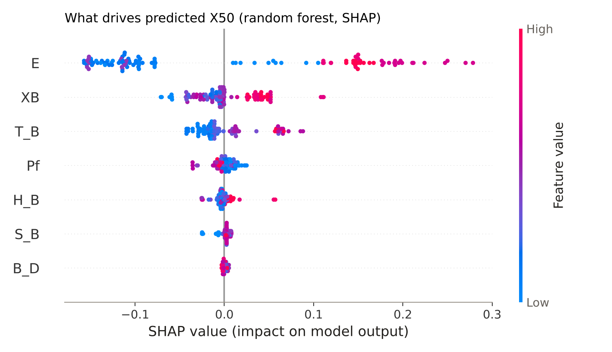

# Blast fragmentation and cost

**Which blast design breaks rock to the right size for the lowest cost, for soft, medium and hard rock?**

Using 110 real blasts from 10 mines, I used machine learning to find what drives fragment size. Then I used the Kuz-Ram model, calibrated to each site, to find the cheapest design that meets the size and boulder limits.

| | Soft (Akdaglar) | Medium (Mrica) | Hard (Murgul) |
|---|---|---|---|
| Cost now → recommended ($/m³) | 3.76 → 2.02 | 1.67 → 0.91 | 2.59 → 2.61 |
| Change | **−46%** | **−45%** (field trial first) | +0.8% (current design doesn't fit the hole) |



---

## The key finding: why ML doesn't set the design

Across all blasts, more explosive goes with smaller rock. **Inside each mine, though, the sign flips at half the sites.** Blasters load more explosive where the rock is hard to break, so powder factor partly marks *difficult* blasts. A model trained on this data can't be trusted to say what happens when we change the powder factor.



So the project splits the work:
- **Machine learning explains what matters.** It compares five models, checks them with SHAP, and tests whether they follow physics.
- **Calibrated Kuz-Ram makes the decisions.** It is a physics model, so it responds correctly when the design changes.

## Results

### 1. Predicting X50 (median fragment size)

| Model | R², new blasts at known mines | R², a mine never seen |
|---|---|---|
| Mean (baseline) | −0.01 | −0.20 |
| Log-linear | 0.59 | 0.10 |
| Random forest | **0.78** | −0.11 |
| Gradient boosting | 0.77 | −0.20 |
| Physics-constrained GBM (monotonic) | 0.77 | **0.15** |

The models work for mines they have seen, with an average error of about 5.6 cm, but they don't carry over to a new mine. Rock stiffness E is the same for every blast at a site, so it acts as a mine fingerprint.



### 2. What drives the prediction (SHAP)



- E (the mine) dominates, with an average impact of 13 cm.
- Block size and stemming push X50 up, as physics expects.
- Powder factor pushes X50 down, as physics expects, but only by about 0.8 cm. That is consistent with the confounding above.

### 3. Kuz-Ram calibrated per site

X50 (cm) = A · K^−0.8 · Q^(1/6) · (115 / RWS)^(19/30), where K is the powder factor and Q is the kg of explosive per hole. The rock factor A is solved from each blast, and the site median is used.

| Rock class | Site | A | Error at site |
|---|---|---|---|
| Soft | Akdaglar | 7.32 | 5.1 cm |
| Medium | Mrica | 3.33 | 2.6 cm |
| Hard | Murgul | 9.87 | 3.7 cm |

### 4. Recommended designs

The grid search covers about 67,000 designs per rock class: powder factor 0.22–1.26 kg/m³, burden ÷ diameter 25–39, spacing ÷ burden 1.0–1.5. Every design must meet these constraints:
- X50 ≤ 30 cm
- at most 5% boulders over 1 m (Rosin–Rammler with Cunningham's n)
- the charge fits in the hole
- 2 ≤ bench ÷ burden ≤ 6.8

| Rock | Powder factor | B/D | S/B | X50 (cm) | Cost ($/m³) | Note |
|---|---|---|---|---|---|---|
| Soft | 0.76 → 0.42 | 22.5 → 27.5 | 1.14 → 1.45 | 18.4 → 29.8 | 3.76 → 2.02 | Aggregate quarry may want small rock on purpose |
| Medium | 0.45 → 0.22 | 32.9 → 39.3 | 1.20 → 1.50 | 15.4 → 26.6 | 1.67 → 0.91 | Sits on 3 edges of the data range: trial first |
| Hard | 0.61 → 0.61 | 30.3 → 25.8 | 1.00 → 1.35 | 30.0 → 29.9 | 2.59 → 2.61 | Current design needs 6.2 m of charge, only 5.9 m free |

Full table: [`results/recommended_designs.csv`](results/recommended_designs.csv)

### 5. Sensitivity

| Scenario | Soft | Medium | Hard |
|---|---|---|---|
| Drilling ±20% | ±14.3% | ±14.5% | ±13.7% |
| Explosive ±20% | ±4.2% | ±4.8% | ±4.7% |
| Rock 10% harder (A × 1.1) | +10.2% | 0% | +12.4% |

**Drilling price matters about 3× more than explosive price.** Full table: [`results/sensitivity.csv`](results/sensitivity.csv)

## Limitations
- Each rock class rests on one site, so A mixes rock properties with site practice and measurement method.
- Hole size (102 mm ANFO) and unit prices are typical assumptions, not the mines' real numbers.
- Kuz-Ram's own error is about 3–5 cm at each site.
- There are no flyrock or vibration limits, and the model counts blasting cost only, not loading or crushing (mine-to-mill).

## Repository

```
├── notebooks/Blasting_Proj.ipynb   full analysis, with explanations and formulas
├── app/
│   ├── streamlit_app.py            interactive design explorer
│   └── blast_model.py              calibrated Kuz-Ram, cost and optimiser
├── data/                           blasts, rock classes, cost assumptions + DATA_NOTES.md
├── results/                        recommended designs and sensitivity tables
├── images/                         figures used above
├── requirements.txt                for the app
└── requirements-notebook.txt       for the notebook
```

## Run it

```bash
pip install -r requirements.txt
streamlit run app/streamlit_app.py
```

In the app you can pick a rock class, move the powder factor, burden and spacing, and see X50, boulders, cost and whether the charge fits. You can also change prices and targets and watch the cheapest design move.

To run the notebook: `pip install -r requirements-notebook.txt`, then open `notebooks/Blasting_Proj.ipynb`. In Google Colab, upload the three CSVs from `data/` and set `DATA = "/content/"` and `RESULTS = ""` in the loading cell. Model scores can shift in the second decimal between scikit-learn versions.

## Data source
Hudaverdi, T., Kulatilake, P.H.S.W. & Kuzu, C. (2011). Prediction of blast fragmentation using multivariate analysis procedures. *International Journal for Numerical and Analytical Methods in Geomechanics*, 35, 1318–1333. See [`data/DATA_NOTES.md`](data/DATA_NOTES.md) for columns and corrections.

---
Brandon Kazangarare · Mining Engineering, Central South University
